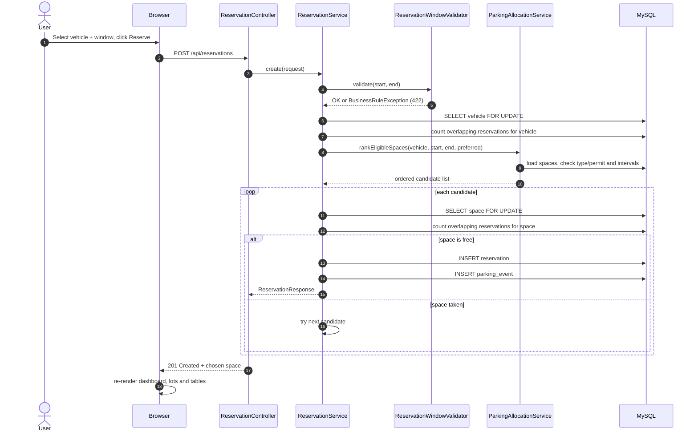

# Design Document

This document explains how the Smart Parking Allocation System is built, why
the main rules are implemented the way they are, and which data structures and
object-oriented principles are demonstrated. It is written to support a college
project report and an oral demonstration.

---

## 1. Goals and constraints

| Goal | Design decision |
|---|---|
| Java-only backend | Spring Boot 3.3.5, Spring MVC, Spring Data JPA, Java 17 |
| MySQL database | MySQL 8.x / MariaDB 10.4+, InnoDB, foreign keys and indexes |
| HTML/CSS/JavaScript frontend | Static files served by Spring Boot from `src/main/resources/static` |
| All business logic in Java | JavaScript only fetches, renders and sends commands |
| Beginner-friendly | Small classes, constructor injection, records for DTOs, no Lombok or code generation |
| Demonstrate DSA | `HashMap`, `ArrayList`, `PriorityQueue`, weighted graph, Dijkstra, min-heap |
| Demonstrate OOP | Abstract classes, inheritance, polymorphism, encapsulation, composition |
| Safe concurrent booking | Row locks, `READ_COMMITTED`, authoritative overlap re-check, optimistic version |
| Easy demonstration | Simulated clock, expiry button, waiting-list processor button, seeded data |

---

## 2. Layered architecture

```text
Browser (HTML + CSS + vanilla JS)
        |
        |  fetch() JSON over HTTP
        v
REST controllers          com.smartparking.controller
        |
        v
Service layer             com.smartparking.service
  - reservation rules
  - smart allocation
  - waiting list
  - fee / clock / queries
        |
        +---------------------------+
        |                           |
        v                           v
Spring Data JPA repositories   Algorithm package
  com.smartparking.repository   com.smartparking.algorithm
        |                           |
        v                           +-- WeightedGraph + Dijkstra
MySQL / MariaDB                     +-- PriorityQueue waiting list
  (source of truth)                 +-- HashMap / ArrayList index
```

### Layer responsibilities

| Layer | What it may do | What it must not do |
|---|---|---|
| Controller | Validate input, call a service, choose the HTTP status | Contain allocation or overlap logic |
| Service | Enforce business rules, open transactions, publish events | Build HTML or parse HTTP |
| Repository | Query and persist entities | Decide whether a booking is allowed |
| Algorithm | Pure data structures and ordering | Access the database |
| Frontend | Render state and send commands | Decide which space is "best" |

The frontend never receives a list of "allowed spaces" and chooses one. It sends
`vehicleId`, `startTime`, `endTime` and an optional `preferredSpaceId`; the Java
backend performs every check and returns the chosen space.

---

## 3. Main request flows

### 3.1 Create a reservation



### 3.2 Cancel / check out / expire a reservation

1. The reservation row is locked with `SELECT ... FOR UPDATE`.
2. The status changes to `CANCELLED`, `COMPLETED` or `EXPIRED`.
3. A `ParkingEvent` row is inserted for the audit trail.
4. `parkingIndex.removeReservationAfterCommit(id)` removes the interval only
   after the transaction commits.
5. A `ReservationReleasedEvent` is published.
6. `WaitingListProcessor` listens with
   `@TransactionalEventListener(AFTER_COMMIT)`, so it runs only for committed
   releases. It tries each waiting request in priority order.

Each waiting allocation attempt runs in its own `REQUIRES_NEW` transaction.
One failed attempt therefore does not roll back a successful allocation for a
later request.

### 3.3 Space status on the dashboard

Space status is **derived**, not stored:

| Condition at simulated `now` | Status |
|---|---|
| `CHECKED_IN` reservation | `OCCUPIED` |
| `RESERVED` reservation whose `start <= now < end` | `RESERVED` |
| No current active reservation | `AVAILABLE` |

This avoids a second copy of the truth in `parking_spaces`. A future
reservation does not make a space unavailable today; the overlap check handles
the requested time window.

---

## 4. Smart allocation algorithm

### 4.1 Eligibility

A space is eligible when **all** of these are true:

1. `space.canAccommodate(vehicle)` returns `true`.
2. The in-memory `ParkingIndex` has no overlapping interval.
3. The database has no overlapping `RESERVED` or `CHECKED_IN` reservation.
4. If the user chose a preferred space, that space must be compatible;
   otherwise the request fails with `422 Unprocessable Entity`.

### 4.2 Compatibility

| Vehicle | Car space | Two-wheeler space | Accessible space |
|---|---|---|---|
| Car, no permit | Yes | No | No |
| Car, permit | Yes | No | Yes |
| Two-wheeler, no permit | No | Yes | No |
| Two-wheeler, permit | No | Yes | Yes |

The rule is implemented by the space subclasses, not by a type switch in the
service.

### 4.3 Ordering

`NearestAvailableSpacePolicy` sorts candidates by:

1. **Dijkstra travel time** from `ENTRANCE` to the lot (lower is better).
2. **Floor number** (lower is better).
3. **Space code** (lexicographic, for deterministic results).

With the seeded road graph:

```text
ENTRANCE --3-- LOT-A
ENTRANCE --7-- LOT-B
ENTRANCE --12- LOT-C
LOT-A ---5--- LOT-B
LOT-B ---4--- LOT-C
LOT-A ---9--- LOT-C
```

Dijkstra results:

| Lot | Shortest time | Path |
|---|---|---|
| LOT-A | 3 min | `ENTRANCE -> LOT-A` |
| LOT-B | 7 min | `ENTRANCE -> LOT-B` |
| LOT-C | **11 min** | `ENTRANCE -> LOT-B -> LOT-C` (shorter than the direct 12) |

This is the key demonstration that Dijkstra is doing real work: the direct road
to LOT-C is not the shortest path.

### 4.4 Why the space is locked and re-checked

The candidate list is a snapshot. Between ranking and inserting, another
request could take the same space. The booking transaction therefore:

1. Locks the vehicle row (`PESSIMISTIC_WRITE`) to serialise bookings for the
   same vehicle.
2. Locks the chosen space row.
3. Re-runs the overlap query with `READ_COMMITTED` so committed bookings are
   visible.
4. Inserts only if the re-check is clean; otherwise it tries the next
   candidate.

The lock order is always **vehicle → space**, which keeps concurrent booking
transactions consistent and reduces the chance of deadlock.

### 4.5 Overlap rule

Two intervals overlap when:

```text
existing.start < requested.end
AND
existing.end > requested.start
```

This is the standard half-open interval test. Examples:

| Existing | Requested | Overlap? | Reason |
|---|---|---|---|
| 10:00–12:00 | 12:00–14:00 | No | Back-to-back is allowed |
| 10:00–12:00 | 09:00–11:00 | Yes | Partial overlap |
| 10:00–12:00 | 11:00–13:00 | Yes | Partial overlap |
| 10:00–12:00 | 10:30–11:30 | Yes | Requested inside existing |
| 10:00–12:00 | 09:00–13:00 | Yes | Existing inside requested |
| 10:00–12:00 | 12:01–14:00 | No | Gap after the existing booking |

Only `RESERVED` and `CHECKED_IN` block a space. `CANCELLED`, `COMPLETED` and
`EXPIRED` do not.

The same rule is applied to the vehicle: one vehicle cannot have two
overlapping active reservations, even in different spaces.

---

## 5. Waiting list design

### 5.1 Data structures

```java
PriorityQueue<WaitingTicket> queue = new PriorityQueue<>(WaitingTicket.PRIORITY);
Map<Long, WaitingTicket> ticketsById = new HashMap<>();
```

- `PriorityQueue` gives `O(log n)` insertion and removal of the highest
  priority ticket, and `O(1)` peek.
- `HashMap` gives average `O(1)` lookup by waiting-request id.
- `WaitingTicket` is a lightweight record, not a JPA entity, so the queue can
  be read outside a transaction without lazy-loading exceptions.

### 5.2 Priority order

```java
Comparator.comparingInt(WaitingTicket::accessPriority).reversed()
        .thenComparing(WaitingTicket::arrivalTime)
        .thenComparing(WaitingTicket::id)
```

1. Accessibility permit holders (`accessPriority = 1`) before standard users
   (`accessPriority = 0`).
2. Earlier arrival time first.
3. Lower id first, so the order is deterministic.

### 5.3 Persistence and restart behaviour

`waiting_requests` is the durable copy. On `ApplicationReadyEvent`, the service
loads all `WAITING` rows and rebuilds the heap. A restart therefore does not
lose the queue.

### 5.4 Re-ranking when a permit changes

If a vehicle's accessibility permit is granted or removed, its
`accessPriority` changes. `WaitingListService.refreshRanking()` updates the
stored priority and rebuilds the heap, because changing a key inside a
`PriorityQueue` does not re-heapify the existing element. A
`PriorityChangedEvent` triggers a fresh allocation attempt after commit.

### 5.5 Reconsideration

After a release, `WaitingListProcessor` iterates over a priority-ordered copy
of the queue. For each request it:

1. Reloads and locks the waiting row.
2. Expires the request if its window has passed.
3. Locks the vehicle.
4. Runs the same allocation algorithm used by normal bookings.
5. On success: marks the request `ALLOCATED`, stores the reservation id,
   removes it from the heap and writes a history event.
6. On failure: leaves it in the queue and continues with the next request.

A waiting request is never forced into an incompatible or overlapping space;
it simply stays queued.

---

## 6. Data structures and complexity

| Structure | Where | Purpose | Complexity |
|---|---|---|---|
| `HashMap` | `ParkingIndex.spacesById` | Space lookup by id | Average `O(1)` |
| `HashMap` | `ParkingIndex.vehiclesByNumber` | Vehicle lookup by normalised number | Average `O(1)` |
| `HashMap` | `ParkingIndex.reservationsById` | Interval lookup by reservation id | Average `O(1)` |
| `HashMap<Long, ArrayList<ReservationInterval>>` | `ParkingIndex.intervalsBySpaceId` | Intervals grouped by space | `O(1)` bucket access, `O(k)` scan for `k` intervals |
| `ArrayList` | `ParkingAllocationService` candidates | Preserve ranked order | `O(1)` append, `O(n)` scan |
| `PriorityQueue` (min-heap) | `DijkstraShortestPath` | Always expand the nearest node | `O(log V)` insert/poll |
| `PriorityQueue` (max-priority) | `WaitingListService` | Highest-priority waiting request | `O(log n)` insert/poll |
| `HashMap` | `WaitingListService.ticketsById` | Queue index by id | Average `O(1)` |
| Adjacency list `HashMap<String, List<Edge>>` | `WeightedGraph` | Sparse road graph | `O(V + E)` memory |
| `HashSet`/`HashMap` distances | Dijkstra | Best known distance per node | `O(V)` memory |

### Algorithm complexity

| Operation | Complexity | Notes |
|---|---|---|
| Register vehicle | `O(1)` expected | Unique index on `vehicle_number` |
| Smart allocation | `O(S · I + S log S)` | `S` compatible spaces, `I` intervals per space, plus sorting |
| Overlap query (DB) | Index-assisted | Uses `(space_id, status, start_time, end_time)` |
| Dijkstra | `O((V + E) log V)` | `V` nodes, `E` road segments |
| Enqueue waiting request | `O(log W)` | `W` waiting requests |
| Process waiting list | `O(W log W + W · A)` | `A` is allocation cost per attempt |
| Dashboard query | `O(S + R)` | `S` spaces, `R` active reservations |
| Fee calculation | `O(1)` | Duration arithmetic and rounding |

The in-memory index is a **fast pre-check**, not the source of truth. The
database query inside the locked transaction is always the final authority.

---

## 7. Database design

### 7.1 Tables

| Table | Purpose | Important constraints |
|---|---|---|
| `parking_lots` | 3 lots and their graph node | `UNIQUE(code)`, `UNIQUE(travel_node)` |
| `parking_spaces` | 24 spaces, single-table inheritance | `UNIQUE(code)`, FK `lot_id`, `CHECK(floor_number >= 0)` |
| `vehicles` | Registered vehicles, single-table inheritance | `UNIQUE(vehicle_number)` |
| `reservations` | Bookings and lifecycle | `UNIQUE(reservation_code)`, FKs, `CHECK(end_time > start_time)`, `version` |
| `waiting_requests` | Durable waiting list | FKs, `CHECK(requested_end_time > requested_start_time)`, `CHECK(access_priority >= 0)` |
| `parking_events` | Audit trail | Indexed by `occurred_at` and `vehicle_number` |
| `road_segments` | Weighted graph | `UNIQUE(from_node, to_node)`, `CHECK(travel_minutes > 0)` |

### 7.2 Indexes

- `idx_reservation_space_time (space_id, status, start_time, end_time)` supports
  the per-space overlap query.
- `idx_reservation_vehicle_time (vehicle_id, status, start_time, end_time)`
  supports the per-vehicle overlap query.
- `idx_space_lot (lot_id)` and `idx_space_lot_floor (lot_id, floor_number)`
  support lot/floor queries.
- `idx_waiting_status_arrival (status, arrival_time)` supports queue rebuild.
- `idx_event_occurred (occurred_at)` supports history ordering.

### 7.3 Transactions and isolation

| Concern | Mechanism |
|---|---|
| Two users booking the same space | `SELECT ... FOR UPDATE` on the space row |
| Same vehicle booking twice | `SELECT ... FOR UPDATE` on the vehicle row |
| Reading committed bookings during re-check | `Isolation.READ_COMMITTED` |
| Lost update on status changes | `@Version` optimistic lock on `Reservation` and `WaitingRequest` |
| One bad waiting allocation rolling back others | `REQUIRES_NEW` per attempt |
| Index updated for a rolled-back booking | `afterCommit` transaction synchronization |

The default isolation level is deliberately raised only for booking
transactions. Read-only dashboard queries do not need it.

### 7.4 Why `parking_events.reservation_id` is not a foreign key

History should survive maintenance that removes old reservations. The audit
row stores `vehicle_number`, `space_code` and `lot_code` as text so it remains
readable even if the referenced rows are archived.

---

## 8. Object-oriented design

### 8.1 Abstraction

`ParkingSpace` is abstract and declares:

```java
public abstract boolean canAccommodate(Vehicle vehicle);
public abstract boolean requiresPermit();
public abstract SpaceKind getKind();
```

`Vehicle` is abstract and declares `getKind()`. The service layer works with
the abstractions, never with concrete subclasses.

### 8.2 Inheritance

- `CarSpace`, `TwoWheelerSpace`, `AccessibleSpace` extend `ParkingSpace`.
- `CarVehicle`, `TwoWheelerVehicle` extend `Vehicle`.
- `NearestAvailableSpacePolicy` extends `SlotSelectionPolicy`.

JPA maps both hierarchies with `InheritanceType.SINGLE_TABLE` and a
discriminator column, so the database stays simple while Java keeps real
polymorphism.

### 8.3 Polymorphism

The allocation service calls `space.canAccommodate(vehicle)`. The JVM dispatches
to the correct subclass. Adding a new space type (for example, an EV charging
space) means adding a subclass, not editing a long `if/else` chain.

### 8.4 Encapsulation

- Entities keep fields private and expose getters/setters only where needed.
- `ParkingIndex` synchronises all map access and returns immutable copies from
  `snapshotIntervals()`.
- The waiting queue is private; callers use `orderedIds()`, `list()` and
  `removeFromQueue()`.

### 8.5 Composition

- A lot **has** spaces.
- A reservation **has** a vehicle and a space.
- `WaitingListService` **has** a priority queue and a map.
- `ParkingIndex` **has** interval lists.
- `WeightedGraph` **has** an adjacency list.

### 8.6 Strategy pattern

`SlotSelectionPolicy` is an abstract strategy. The default
`NearestAvailableSpacePolicy` orders by travel time, floor and code. A different
policy (for example, "prefer ground floor" or "balance lot usage") can be added
without changing `ParkingAllocationService`.

---

## 9. Reservation lifecycle

```text
                 cancel
        +------------------------+
        |                        v
   +---------+   check-in   +------------+   check-out   +-----------+
   | RESERVED|------------->| CHECKED_IN |-------------->| COMPLETED |
   +---------+              +------------+               +-----------+
        |
        | expiry (start + grace < now, not checked in)
        v
   +---------+
   | EXPIRED |
   +---------+
```

Rules:

| Transition | Allowed when |
|---|---|
| `RESERVED -> CHECKED_IN` | At most 30 minutes before start and not after end |
| `RESERVED -> CANCELLED` | Any time while still `RESERVED` |
| `RESERVED -> EXPIRED` | `start + graceMinutes < now` and never checked in |
| `CHECKED_IN -> COMPLETED` | Check-out; fee is calculated from `checkedInAt` |
| Any other transition | Rejected with `422 Unprocessable Entity` |

---

## 10. Fee calculation

| Vehicle | Rate | Minimum | Rounding |
|---|---|---|---|
| Car | ₹50 per hour | 1 hour | Part hours round up |
| Two-wheeler | ₹20 per hour | 1 hour | Part hours round up |

Example: a car checked in for 90 minutes is charged for 2 hours = ₹100.00.
The calculation uses `BigDecimal` and `RoundingMode.CEILING` on the hour count.

---

## 11. Simulated clock

`ClockService` stores an offset in minutes:

```java
public LocalDateTime now() {
    return realNow().plusMinutes(offsetMinutes);
}
```

Every business rule uses `clockService.now()`:

- reservation window validation,
- check-in time,
- expiry cutoff,
- fee duration,
- waiting-request expiry,
- dashboard status.

The dashboard can advance the clock by 15, 60 or 180 minutes or reset it. This
makes expiry and fee demonstrations possible without waiting in real time. The
offset is in memory only; restarting the application resets it to real time.

---

## 12. Validation and error handling

| Situation | HTTP status | Example message |
|---|---|---|
| Created | `201` | Reservation response |
| Successful read/action | `200` | Reservation or dashboard |
| Waiting request deleted | `204` | No body |
| Bean validation failure | `400` | `vehicleNumber: must not be blank` |
| Unknown id | `404` | `Vehicle 99 was not found` |
| Overlap / duplicate / full lot | `409` | `No compatible parking space is available...` |
| Incompatible type or missing permit | `422` | `Space A-A-01 requires an accessibility permit` |
| Invalid time window | `422` | `End time must be after start time` |
| Unexpected server error | `500` | Generic message; details in the backend log |

`GlobalExceptionHandler` converts exceptions into one consistent JSON shape:

```json
{
  "timestamp": "2026-10-29T22:15:00",
  "status": 422,
  "error": "Unprocessable Entity",
  "message": "Space A-A-01 requires an accessibility permit",
  "path": "/api/reservations",
  "details": []
}
```

The frontend displays `message` and appends any `details` entries, so the user
always sees a clear reason instead of a generic failure.

---

## 13. Design trade-offs and limitations

| Decision | Benefit | Limitation |
|---|---|---|
| In-memory `ParkingIndex` | Fast pre-check and a clear DSA demonstration | Not shared between application instances; rebuilt on startup |
| In-memory waiting `PriorityQueue` | Simple, fast, easy to explain | Single-instance only; MySQL is the durable backup |
| Single-table inheritance | Simple schema, real Java polymorphism | Nullable subclass columns in a larger model |
| Derived space status | No stale status column | Slightly more work per dashboard query |
| Pessimistic row locks | Strong protection against double booking | Lower throughput under heavy concurrency |
| Simulated clock in memory | Great for demos and tests | Resets on restart; not suitable for production |
| No authentication | Keeps the mini-project focused | Not a production security model |

For a production system the next steps would be authentication, a distributed
lock or database-level exclusion constraint, multi-instance cache invalidation,
and a persistent audit/event store.

---

## 14. Summary for the viva

1. **Allocation** is a pipeline: compatibility → overlap → ordering → lock →
   re-check → insert.
2. **Dijkstra** proves that the nearest lot is not always the direct road
   (`LOT-C` is 11 minutes via `LOT-B`, not 12 direct).
3. **Polymorphism** decides compatibility; the service does not switch on
   strings.
4. **`PriorityQueue` + `HashMap`** implement the waiting list in `O(log n)` and
   `O(1)` respectively.
5. **Transactions** prevent double booking with vehicle/space row locks and an
   authoritative overlap re-check.
6. **The frontend is thin**: it never decides which space to use.
7. **Tests** cover success, conflict, incompatibility, full lot, expiry,
   check-in/out and waiting-list allocation.
