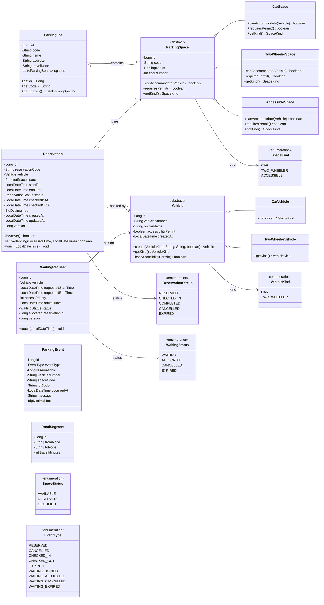

# UML Class Diagram

This document describes the object model of the Smart Parking Allocation
System. The diagram is split into two views so it stays readable:

1. **Domain model** — the JPA entities, inheritance and relationships.
2. **Services and algorithms** — the classes that implement allocation,
   waiting-list priority, Dijkstra travel times and the in-memory index.

The diagrams use [Mermaid](https://mermaid.js.org/), which is rendered by
GitHub, GitLab and many Markdown viewers. They are also valid input for the
Mermaid Live Editor (<https://mermaid.live>).

---

## 1. Domain model

### Relationship notes

| Relationship | Meaning |
|---|---|
| `ParkingLot 1 o-- 0..* ParkingSpace` | One lot contains many spaces. The space owns the foreign key `lot_id`. |
| `ParkingSpace <|-- CarSpace / TwoWheelerSpace / AccessibleSpace` | JPA **single-table inheritance**. All rows live in `parking_spaces`; the `space_kind` discriminator selects the Java subclass. |
| `Vehicle <|-- CarVehicle / TwoWheelerVehicle` | JPA single-table inheritance in `vehicles` with discriminator `vehicle_kind`. |
| `Reservation * --> 1 Vehicle` | A vehicle can have many reservations over time, but at most one active reservation for a given interval. |
| `Reservation * --> 1 ParkingSpace` | A space can have many historical reservations; active intervals must not overlap. |
| `WaitingRequest * --> 1 Vehicle` | The durable copy of a waiting-list entry. It stores `access_priority` and `arrival_time` so the in-memory queue can be rebuilt after a restart. |

`ParkingEvent` and `RoadSegment` are standalone tables. `ParkingEvent.reservation_id`
is deliberately **not** a foreign key so audit history survives maintenance
deletes. `RoadSegment` stores the weighted graph used by Dijkstra.

### Key OOP idea

`ParkingSpace.canAccommodate(Vehicle)` is abstract. Each subclass answers the
compatibility question differently:

- `CarSpace` accepts only `VehicleKind.CAR`.
- `TwoWheelerSpace` accepts only `VehicleKind.TWO_WHEELER`.
- `AccessibleSpace` accepts any vehicle with `accessibilityPermit = true`.

The allocation service therefore never needs a long `if (type == ...)` chain;
it simply asks the space object. This is **polymorphism** replacing
conditional logic.

---

## 2. Services and algorithms

```mermaid
classDiagram
    direction TB

    class ReservationController
    class VehicleController
    class SpaceController
    class LotController
    class WaitingListController
    class DashboardController
    class HistoryController
    class SystemController

    class ReservationService {
        -long graceMinutes
        +create(ReservationRequest) ReservationResponse
        +tryAllocateWaitingRequest(Long) Optional~ReservationResponse~
        +cancel(Long) ReservationResponse
        +checkIn(Long) ReservationResponse
        +checkOut(Long) ReservationResponse
        +expireOverdueReservations() int
        +get(Long) ReservationResponse
        +list(...) List~ReservationResponse~
    }

    class ParkingAllocationService {
        +rankEligibleSpaces(Vehicle, LocalDateTime, LocalDateTime, Long) List~ParkingSpace~
    }

    class WaitingListService {
        -PriorityQueue~WaitingTicket~ queue
        -Map~Long,WaitingTicket~ ticketsById
        +enqueue(WaitingRequestCreate) WaitingResponse
        +list() List~WaitingResponse~
        +cancel(Long) WaitingResponse
        +refreshRanking() void
        +removeFromQueue(Long) void
        +orderedIds() List~Long~
        +loadQueue() void
    }

    class WaitingListProcessor {
        +onReservationReleased(ReservationReleasedEvent) void
        +onPriorityChanged(PriorityChangedEvent) void
        +processWaitingList() int
    }

    class ParkingQueryService {
        +dashboard() DashboardResponse
        +lots() List~LotResponse~
        +spaces(Long, SpaceKind, SpaceStatus, String) List~SpaceResponse~
        +space(Long) SpaceResponse
        +travelTimes() TravelTimeResponse
    }

    class VehicleService {
        +register(VehicleRequest) VehicleResponse
        +list(String) List~VehicleResponse~
        +updatePermit(Long, boolean) VehicleResponse
    }

    class TravelTimeService {
        +minutesByLotId() Map~Long,Integer~
        +response() TravelTimeResponse
    }

    class ParkingFeeService {
        +calculateFee(VehicleKind, LocalDateTime, LocalDateTime) BigDecimal
    }

    class ClockService {
        -long offsetMinutes
        +now() LocalDateTime
        +realNow() LocalDateTime
        +advance(long) void
        +reset() void
        +getOffsetMinutes() long
    }

    class ReservationWindowValidator {
        +validate(LocalDateTime, LocalDateTime) void
    }

    class ParkingEventService {
        +recordReservation(EventType, Reservation, String, BigDecimal) void
        +recordWaiting(EventType, WaitingRequest, String) void
    }

    class SlotSelectionPolicy {
        <<abstract>>
        +order(Vehicle, List~ParkingSpace~, Map~Long,Integer~) List~ParkingSpace~
        #comparator(Map~Long,Integer~) Comparator~ParkingSpace~
    }

    class NearestAvailableSpacePolicy {
        #comparator(Map~Long,Integer~) Comparator~ParkingSpace~
    }

    class WeightedGraph {
        -Map adjacency
        +addNode(String) void
        +addUndirectedEdge(String, String, int) void
        +neighbors(String) List~Edge~
        +nodes() Set~String~
    }

    class DijkstraShortestPath {
        +shortestDistances(WeightedGraph, String)$ Map~String,Integer~
    }

    class ParkingIndex {
        -Map~Long,ParkingSpace~ spacesById
        -Map~String,Vehicle~ vehiclesByNumber
        -Map~Long,ReservationInterval~ reservationsById
        -Map intervalsBySpaceId
        +rebuild() void
        +hasOverlap(Long, LocalDateTime, LocalDateTime) boolean
        +indexReservationAfterCommit(Reservation) void
        +removeReservationAfterCommit(Long) void
        +findSpace(Long) Optional~ParkingSpace~
        +findVehicle(String) Optional~Vehicle~
        +snapshotIntervals() Map
    }

    class ReservationInterval {
        <<record>>
        +Long reservationId
        +Long spaceId
        +String vehicleNumber
        +LocalDateTime start
        +LocalDateTime end
        +overlaps(LocalDateTime, LocalDateTime) boolean
    }

    class WaitingTicket {
        <<record>>
        +Long id
        +Long vehicleId
        +String vehicleNumber
        +VehicleKind vehicleKind
        +boolean accessibilityPermit
        +int accessPriority
        +LocalDateTime arrivalTime
        +LocalDateTime requestedStartTime
        +LocalDateTime requestedEndTime
        +PRIORITY$ Comparator~WaitingTicket~
    }

    ReservationController --> ReservationService
    WaitingListController --> WaitingListService
    WaitingListController --> WaitingListProcessor
    DashboardController --> ParkingQueryService
    SpaceController --> ParkingQueryService
    LotController --> ParkingQueryService
    VehicleController --> VehicleService
    SystemController --> ClockService
    SystemController --> ParkingQueryService

    ReservationService --> ParkingAllocationService
    ReservationService --> ReservationWindowValidator
    ReservationService --> ParkingFeeService
    ReservationService --> ParkingEventService
    ReservationService --> ParkingIndex
    ReservationService --> ClockService
    ReservationService ..> WaitingListProcessor : publishes release event

    ParkingAllocationService --> SlotSelectionPolicy
    ParkingAllocationService --> ParkingIndex
    ParkingAllocationService --> TravelTimeService
    ParkingAllocationService --> ParkingSpace

    SlotSelectionPolicy <|-- NearestAvailableSpacePolicy
    NearestAvailableSpacePolicy ..> WeightedGraph

    TravelTimeService --> WeightedGraph
    TravelTimeService --> DijkstraShortestPath

    WaitingListProcessor --> WaitingListService
    WaitingListProcessor --> ReservationService

    WaitingListService --> WaitingTicket : stores
    ParkingIndex --> ReservationInterval : stores
```

### Service responsibilities

| Class | Responsibility |
|---|---|
| `ReservationService` | Owns every reservation state change. Runs the booking transaction, locks rows, re-checks overlap, cancels, checks in/out and expires. |
| `ParkingAllocationService` | Filters incompatible or overlapping spaces, then asks a `SlotSelectionPolicy` to order the candidates. |
| `WaitingListService` | Maintains the in-memory `PriorityQueue` and `HashMap` index, and persists `WaitingRequest` rows. |
| `WaitingListProcessor` | Listens for committed release/priority events and tries each waiting request in priority order. |
| `ParkingQueryService` | Read-only projections for the dashboard, lots, spaces and travel times. Space status is derived from active reservations. |
| `VehicleService` | Normalises and registers vehicles, rejects duplicates, updates permits and triggers re-ranking. |
| `TravelTimeService` | Loads road segments into a `WeightedGraph` and runs Dijkstra from `ENTRANCE`. |
| `ParkingIndex` | In-memory `HashMap`/`ArrayList` index used as a fast overlap pre-check. MySQL remains authoritative. |
| `ClockService` | Supplies the simulated `now()` used by expiry, check-in and fee logic. |

### Controller layer

All controllers are thin: they validate the request, call one service method
and return a DTO. No allocation, overlap or priority decision is made in a
controller or in JavaScript.

| Controller | Base path |
|---|---|
| `DashboardController` | `/api/dashboard` |
| `LotController` | `/api/lots` |
| `SpaceController` | `/api/spaces` |
| `VehicleController` | `/api/vehicles` |
| `ReservationController` | `/api/reservations` |
| `WaitingListController` | `/api/waiting-list` |
| `HistoryController` | `/api/history` |
| `SystemController` | `/api/system` |

---

## 3. Inheritance and composition summary

### Inheritance

- `ParkingSpace` → `CarSpace`, `TwoWheelerSpace`, `AccessibleSpace`
- `Vehicle` → `CarVehicle`, `TwoWheelerVehicle`
- `SlotSelectionPolicy` → `NearestAvailableSpacePolicy`

### Composition / aggregation

- `ParkingLot` owns its `ParkingSpace` collection.
- `Reservation` is composed of one `Vehicle` and one `ParkingSpace`.
- `WaitingRequest` references one `Vehicle`.
- `WaitingListService` owns a `PriorityQueue<WaitingTicket>` and a
  `HashMap<Long, WaitingTicket>`.
- `ParkingIndex` owns four `HashMap` indexes, including
  `HashMap<Long, ArrayList<ReservationInterval>>`.
- `WeightedGraph` owns an adjacency list `HashMap<String, List<Edge>>`.

### Why this design is easy to explain

1. **Entities** map directly to MySQL tables and to nouns in the problem
   statement (lot, space, vehicle, reservation, waiting request).
2. **Services** contain the verbs (allocate, reserve, cancel, check in, expire).
3. **Algorithms** are isolated in `com.smartparking.algorithm` and have no
   Spring or JPA dependency, so each data structure can be demonstrated on its
   own.
4. **DTO records** keep the REST contract separate from the database entities.
